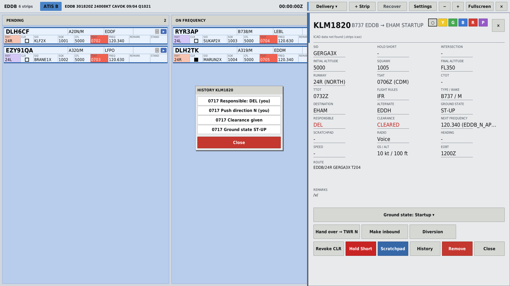
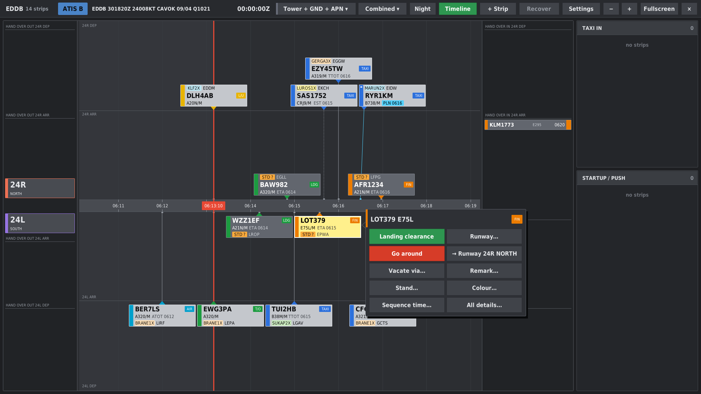

# StripBay

🇬🇧 [English](README.md) · 🇩🇪 Deutsch

Touch-Flugstreifen für **EuroScope**: ein eigenes Fenster mit elektronischen Flugstreifen für Delivery, Apron, Ground und Tower. Fertige Profile sind für Berlin **EDDB** (Nord/Süd getrennt), Leipzig **EDDP** und Hannover **EDDV** vorhanden.

Autoren: Luis Korb, Sören Pflug · aktuelle Version: **4.1.2**

## Funktionsumfang

- **Bays und Drag and Drop:** Jede Verschiebung setzt den Ground State in EuroScope. Dieser ist auch für TopSky, das Ground Radar Plugin und andere Lotsen sichtbar. Wird der Status an anderer Stelle geändert, folgt der Streifen automatisch.
- **Einheitliche Übergabe:** Wer einen Streifen bearbeitet, ist zuständig. Die Übergabe wird der nächsten Stelle angeboten und von dieser angenommen. Bei Ablehnung geht der Streifen an die übergebende Stelle zurück.
- **Gemischter Betrieb:** Setzt eine besetzte Stelle StripBay nicht ein, wird die Übergabekette dadurch nicht unterbrochen, beispielsweise bei Delivery und Tower mit StripBay und Ground ohne StripBay.
- **Zeitstrahl nach DFS-Vorbild** für den Tower: Das gesamte Label ist eine Schaltfläche, das Menü öffnet sich durch langes Drücken; Tag- und Nachtdarstellung.
- **Verlauf je Streifen:** Zuständigkeit, Freigaben, Ground State und Übergaben mit Uhrzeit.
- **Runway-Bay**, Hold Short, Start- und Landefreigabe, nächste Frequenz, METAR und ATIS.
- **Abgleich zwischen den Lotsen** über das Scratchpad, ohne zusätzlichen Server.
- **StripBay Remote:** Darstellung der Streifen auf einem zweiten Windows-Gerät, beispielsweise einem Touchscreen.

## Installation

1. Unter [Releases](../../releases) die aktuelle Datei `StripBay-X.Y.Z.zip` herunterladen und entpacken.
2. In EuroScope **OTHER SET → Plug-ins… → Load** wählen und `StripBay.dll` auswählen.
3. Das Fenster auf den Touchscreen verschieben und **Vollbild** wählen.

EuroScope ist eine 32-Bit-Anwendung, daher wird die DLL für x86 erstellt.

**Alle Lotsen und das Remote-Gerät benötigen dieselbe Hauptversion** (erste Ziffer). Abweichungen in der zweiten oder dritten Ziffer sind unkritisch.

## Erstellen aus dem Quellcode

- **GitHub Actions:** Jeder Push auf `main` erzeugt die DLL (Actions → letzter Lauf → Artifacts). Für ein Release den Workflow **Build** manuell starten (Run workflow, Option „release“ aktivieren). Es wird das Release `vX.Y.Z` anhand der Version in `Version.h` angelegt.
- **Lokal:** `INSTALL.bat` ausführen. Das Skript sucht das SDK, erstellt Release/x86 und installiert nach `%APPDATA%\EuroScope\Plugins\StripBay`.
- **Manuell:** `StripBay.sln` in Visual Studio 2022 öffnen und **Release / x86** wählen.

Der Ordner `StripBay/sdk/` enthält `EuroScopePlugIn.h` und `EuroScopePlugInDll.lib` aus dem EuroScope-SDK. Diese beiden Dateien gehören dem Autor von EuroScope und fallen nicht unter die MIT-Lizenz.

## Dokumentation

- [Handbuch](docs/MANUAL.de.md) (nur Deutsch): Funktionen, Bedienung, Befehle
- [Änderungsverlauf](docs/CHANGELOG.de.md) (nur Deutsch)
- [StripBay Remote](Remote/README.de.txt)

## Fehler melden

Fehler bitte als [Issue](../../issues/new/choose) mit passender Kategorie melden. Hilfreich sind folgende Angaben: Version, Profil (EDDB/EDDP/EDDV), eigene Station (DEL/GND/TWR/APN), Beschreibung des Ablaufs und des Fehlverhaltens sowie ein Screenshot.

## Lizenz

[MIT](LICENSE)
