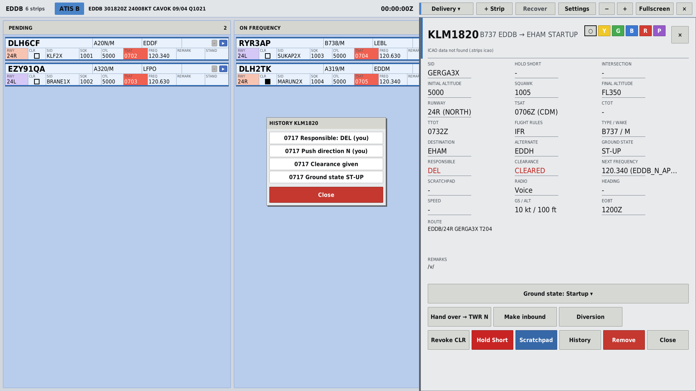
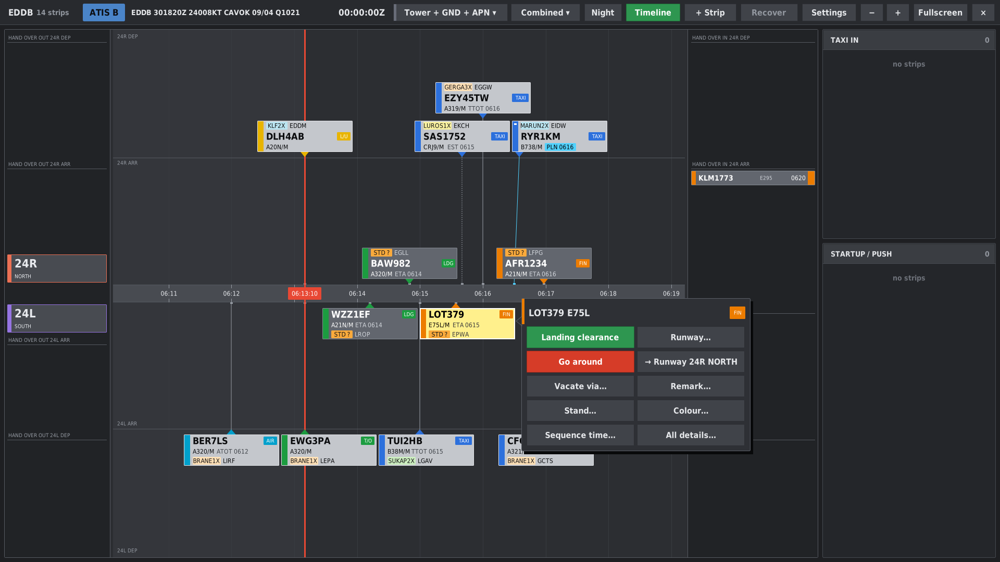

# StripBay

🇬🇧 English · 🇩🇪 [Deutsch](README.de.md)

Touch flight strips for **EuroScope**: a dedicated window with electronic strips for Delivery, Apron, Ground and Tower. Ready-made profiles for Berlin **EDDB** (north/south split), Leipzig **EDDP** and Hannover **EDDV**.

Authors: Luis Korb, Sören Pflug · current version: **4.1.1**

## Features

- **Bays and drag and drop:** every move sets the ground state in EuroScope, which TopSky, GRP and other controllers see as well. If someone changes the state elsewhere, the strip follows.
- **One consistent handover:** whoever edits a strip is responsible. A handover is offered to the next station and accepted by it. Rejecting sends the strip back.
- **Mixed operation:** if an occupied station does not use StripBay, the chain does not get stuck. For example Delivery and Tower with StripBay, Ground without.
- **Timeline after the DFS design** for Tower: the whole label is one button, menu on long press, day and night colours.
- **History per strip:** responsibility, clearances, ground state and handover with time stamps.
- **Runway bay**, hold short, take-off and landing clearance, next frequency, METAR and ATIS.
- **In sync between controllers** via the scratchpad, no server needed.
- **StripBay Remote:** the strip screen on a second Windows device, e.g. a touchscreen.

## Installation

1. Download the latest `StripBay-X.Y.Z.zip` from [Releases](../../releases) and unzip it.
2. In EuroScope: **OTHER SET → Plug-ins… → Load** and select `StripBay.dll`.
3. Drag the window to the touchscreen and tap **Fullscreen** (Vollbild).

EuroScope is 32-bit, so the DLL is x86.

**All controllers and the Remote device need the same major version** (the first number). Differences in the second or third number are harmless.

## Building

- **GitHub Actions:** every push to `main` builds the DLL (Actions → latest run → Artifacts). To publish a release, run the **Build** workflow manually (Run workflow → tick "release"); it creates the release `vX.Y.Z` from `Version.h`.
- **On your own PC:** double-click `INSTALL.bat`. It finds the SDK, builds Release/x86 and installs to `%APPDATA%\EuroScope\Plugins\StripBay`.
- **By hand:** open `StripBay.sln` in Visual Studio 2022 and select **Release / x86**.

`StripBay/sdk/` contains `EuroScopePlugIn.h` and `EuroScopePlugInDll.lib` from the EuroScope SDK. These two files belong to the author of EuroScope and are not covered by the MIT licence.

## Documentation

- [Manual](docs/MANUAL.de.md) (German only): all features, operation, commands
- [Changelog](docs/CHANGELOG.de.md) (German only)
- [StripBay Remote](Remote/README.txt)

The user interface and the in-game messages are mostly English; the manual is currently German.

## Reporting bugs

Please open an [issue](../../issues/new/choose) with a suitable label. Helpful details: version, profile (EDDB/EDDP/EDDV), your position (DEL/GND/TWR/APN), what you did and what happened, a screenshot.

## Licence

[MIT](LICENSE)
